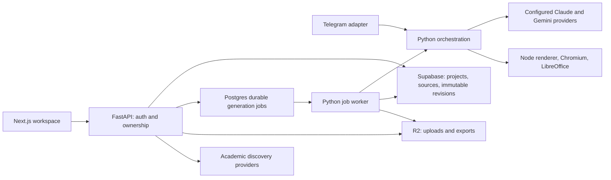

> Superseded by docs/adr/0001-canonical-document-state.md (2026-10-11); kept for history, not current guidance.

# Nashr build plan — 2026-09-22

## Product contract

An education workspace where a user brings sources, writes an article or designs
a presentation, iterates on editable work, inspects its evidence, and exports a
specific saved version. Uzbek, Russian, and English are first-class languages.
Discovery records, extracted passages, model interpretations, and verified support
are different things; the interface must not collapse them into a green check.

## Current architecture (code inspection, not a deployment claim)

Redis supplies cache/rate limits. Supabase supplies identity, ownership and durable
records. The API authenticates and queues work; expensive parsing/generation runs
outside requests. Revisions are full validated snapshots with compare-and-swap
head updates. Article DOCX and presentation renders select immutable revisions.
The legacy `decks` table is a presentation read model. Some shared orchestration
still lives under `packages/bot`; extract it incrementally as workers adopt it.

Already implemented: localized shell and creation, Flexoki design tokens, manual
article editing/history/DOCX, slide text/theme/order editing, revision-aware render
jobs, academic discovery and a provenance view. These are local code capabilities;
they have not all been verified on production.

Gaps: uploads are registered but article sources are not independently processed;
research results are outbound links; article citations cannot be attached in the
editor; article AI workers are not wired to the web queue. A graph of session claims
does not yet represent an article's actual citation relationships.

## Build stages and exit criteria

### Reconciliation with the earlier plans

This plan combines the current workspace work with `BUILD_STATE.md`'s Plan of
Record, `prompts/BUILD_2_PLAN.md`, `RECON_5B.md`, and the original `SPEC.md`.
Historical DONE labels are evidence of past work, not current deployment proof.
The earlier specification's claim that users should never iterate is superseded
by the user's explicit editable, conversational workspace requirement.

| Earlier capability | Current code evidence | Decision and destination |
| --- | --- | --- |
| Parsing, OCR, page chunking | `workers/source/parse_service.py`, `chunker.py` | Reuse in stage 1; do not build another parser |
| Evidence matrix, structured outline, section drafting, hedging | `workers/article/evidence_matrix.py`, `outline_generator.py`, `drafter.py`, `hedging.py`; bot article orchestrator | Keep; adapt persisted identities and wire to web jobs in stage 2 |
| Independent citation verification | `workers/article/citation_verifier.py` | Keep; a manual source attachment is not a verifier verdict |
| GOST/APA/IEEE/Chicago/Vancouver bibliography and richer exports | `workers/article/bibliography.py`, `docx_export.py`, `pdf_export.py` | Reuse through a canonical-document adapter in stage 2; do not replace with labels-only export |
| Academic and domain suggestions | `suggestions/engine.py`, provider registry | Keep working providers; connect to library, expose unavailable providers honestly |
| Lex.uz | `suggestions/providers/lex_uz.py` is explicitly an empty-result stub | Integration remains required; official search link is only an interim affordance |
| Conversational presentation edits, fix-and-deliver, durable sessions, approval/counters | `bot/sessions`, API chat route, presentation orchestrator | Retain and test; extend via revision-safe proposals, not a second chat engine |
| Content critic and brain escalation | `presentation/content_critic.py`, `editorial.py`, `core/brain_loop.py` | Keep fabrication hard-stop; broaden to routing quality judge in stage 3 |
| Tool transport and context caching | `core/gemini_tools.py`, `gemini_cache.py`, `brain_loop.py` | Already wired; retain fallback/signature discipline; live cache savings remain a release check |
| Stage 5b source/history retrieval | Brain loop currently only exposes `edit_slides`; retrieval prompt is a placeholder | Add bounded read-and-continue tools over evidence and user-scoped history; stage 2b below |
| Stage 5b cross-session memory and reflection | Memory prompt placeholder; project session history exists, per-user notes/history store absent | Keep full scope, implement stage 2b with identity isolation and correction semantics |
| Proactive suggestions (Way 3) | Approval machinery exists; caller-origin and persisted proposal provenance need completion | Stage 2b; explicit proposal, accept/reject, never model-granted authorization |
| Free-form intent/intake advisor | Topic reaches editorial context; full style/format intake advisor not established | Extend existing interview, stage 3; user intent remains instructions, never evidence |
| Per-slide briefs/regeneration | Addressable slide fixes exist | Retain; inspect section-slot and neighboring-slide constraints before extending stage 3 |
| Five visual families, real display fonts, three image slots | Image routing/Commons portraits/tier budget exist; full family policy not established | Preserve editorial-engraving, high-contrast-press, sepia-educational, risograph-punk, technical-blueprint in stage 3 |
| Premium image policy, object figures, atmosphere and scrims | Current generated-image tier budgets are bounded; policy differs from earlier premium-unlimited proposal | Keep full feature goal but resolve cost/quality policy before changing paid entitlements; no silent unlimited spending |
| Locale-specific length budgets | Earlier plan explicitly left this open | Stage 3; fit actual Uzbek/Russian/English typography, not one language-blind word cap |
| Taste as loadable skills; Add details / AI Fill | Earlier Plan of Record includes both | Stage 3; versioned design rules and source-grounded fill with a visible proposal |
| Terminal-policy / zero-file rendering / persistence failures | Existing delivery guard and newer revision paths | Retain tests and close remaining render/read-model concurrency gaps in stages 3–4 |

These are inspected code locations, not a claim that every subsystem has passed
new end-to-end tests. Stage-specific tests will establish which pieces are reusable
unchanged and which need repair. Old branch/merge/deployment instructions remain
historical; this plan does not revive abandoned hosting decisions.

### 1. Persistent evidence (active)

- A queued source-processing job parses registered uploads without LLM charges.
- Commit bounded page-located passages atomically, fenced by job ownership. Retries
  reuse committed passages so old revisions keep stable citation identities.
- Expose authenticated project evidence and processing status; failed extraction
  stays visibly failed, with a retry path.
- Attach/remove passages on article blocks; reject mismatched project/source IDs
  on save. Graph edges represent the user's actual attachments, not inferred truth.
- Gate: real text/PDF parsing, route ownership, idempotency, stale-worker behavior,
  citation validation, frontend behavior and types.

### 2. Assisted article workflow

- Save academic discovery records to the project library with provider provenance.
- Retrieve available full text through bounded, SSRF-safe downloads; metadata-only
  records must never masquerade as full-text evidence. Lex.uz integration requires
  a confirmed permitted retrieval contract; currently it is an official search link.
- Source-grounded outline and section drafting, using persisted evidence IDs and
  explicit output language. Scoped suggestions show a diff and require acceptance.
- Paid jobs need a stated cost/allowance, bounded model calls, cancellation/refund
  semantics, and revision-safe proposal acceptance; no blind overwrite of user work.
- Citation and bibliography editing, linked page navigation, publication formatting,
  revision-pinned DOCX/PDF exports.
- Gate: real user journey from uploads to cited multilingual draft to edited export;
  unsupported requests remain unsupported instead of inventing evidence.

### 2b. Complete Build 2 / Stage 5b

- Add bounded source retrieval and conversation-history tools to the existing brain
  loop, retaining signed history and exactly one response per tool call. Start with
  deterministic retrieval; embeddings are an evaluated upgrade, not a prerequisite.
- Persist per-user conversation history and curated memory, enforce isolation in
  SQL and application code, and let users inspect/correct/delete saved preferences.
  Corrections replace stale notes; quoted sources cannot issue memory instructions.
- Capture durable signals and run bounded reflection at defined task boundaries;
  retrieval selects relevant notes, not a growing transcript in every prompt.
- Wire proactive suggestions as persisted proposals with caller-controlled origin,
  revision binding, and accept/reject. Preserve fix allowances and failed-render
  behavior. Do not allow a model to approve its own changes.
- Integrate the existing authored character/standard/retrieval/memory documents;
  never replace them with placeholder text. Cache keys include the complete toolset.
- Gate: source search followed by an edit, empty retrieval, mixed tool calls,
  restart with a parked proposal, corrected memory, and two-user isolation.

### 3. Design workspace completion

- Selected-element editing: layout, positioning, charts, images/replacement/crop.
- Preserve the earlier visual-family, typography, three-image-slot, intake-advisor,
  per-slide brief, locale-budget, routing-judge, loadable-taste and AI Fill scope
  listed in the reconciliation table. Cohesion and variety are separate criteria.
- Undo/redo, reusable theme presets using the full Flexoki palette, conversational
  changes previewed before acceptance, and clear export progress.
- Keep canonical revision and legacy deck read model consistent under concurrent
  renders. Verify HTML/PPTX/PDF against the same revision and asset set.
- Gate: create, directly edit, revise conversationally, restore, and export a deck
  without losing prior changes or claiming success for a zero-file render.

### 4. Workspace resilience and localization

- Durable local draft recovery; offline/reconnect, save retry and conflict recovery
  without silently discarding edits. History/load failures need actionable UI.
- Unified project navigation and source library across both authoring modes.
- Audit remaining auth/marketing strings and generation language in UZ/RU/EN.
- Accessible keyboard editing, responsive panels, cancellation and failure recovery.
- Gate: reload with unsaved work, two-tab conflicts, expired sessions, worker loss,
  partial provider failure and three-language journeys.

### 5. Release and product quality

- Actual product screenshots and truthful copy; pricing from the charged backend
  tiers; checkout/refund reconciliation and observability.
- Apply and verify migrations, build the production image, run owner/isolation and
  full browser journeys, then deploy and smoke-test production.
- Keep the existing hosting decision. Deployment is currently blocked on server
  access; resumed Supabase connectivity alone does not establish API availability.

## Delivery rules

Each stage lands in reviewable vertical slices with tests and a dated handoff.
Backend tests and local UI checks do not establish a production deployment.
Preserve unrelated forensic/review artifacts and the existing dirty worktree.
Do not introduce services, hosting changes, provider changes or automatic paid
model calls merely to complete a checklist. Keep remaining scope visible here.
